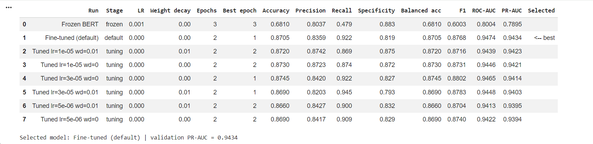

# Assignment 03 — Toxic Comment Classification Using BERT

**Student Name:**  Nazifa Alam
**Student ID:** 1000128863

## 1. Project Overview
This project develops a binary toxic-comment classifier using the pretrained bert-base-uncased model and the Civil Comments dataset.

The project investigates the effectiveness of transfer learning through a frozen BERT baseline, full model fine-tuning, and hyperparameter tuning. Model performance is evaluated using classification metrics, followed by decision-threshold optimization, real-world comment testing, and prediction interpretability using LIME.

The objective is to compare these approaches and examine the model's performance, limitations, and ability to identify toxic language.

## 2. Dataset and Preprocessing

### Dataset
The project uses the **Civil Comments** dataset (`google/civil_comments`) from Hugging Face, containing user comments with toxicity scores.

The toxicity scores were converted into binary labels:
- **0 (Non-toxic):** Toxicity score below 0.5
- **1 (Toxic):** Toxicity score greater than or equal to 0.5

### Data Sampling
A balanced subset was used to reduce computational requirements.

| Dataset | Non-toxic | Toxic | Total |
|---|---:|---:|---:|
| Training | 4,000 | 4,000 | 8,000 |
| Validation | 1,000 | 1,000 | 2,000 |
| Testing | 1,000 | 1,000 | 2,000 |

Balancing the datasets simplifies class comparison but does not reflect the original distribution of toxic comments.

### Tokenization
The `bert-base-uncased` tokenizer was used with:
- Maximum sequence length: **200 tokens**
- Truncation for longer comments
- Dynamic padding within each batch
- Batch size: **16**

These settings were selected to balance text coverage and computational efficiency.

## 3. BERT Model Selection and Justification

### Why BERT-base-uncased?

`bert-base-uncased` was selected because it provides a practical balance between contextual language understanding, model complexity, and computational requirements.

**Key advantages:**

- **Bidirectional understanding:** BERT considers words in both directions, helping interpret expressions based on their surrounding context.
- **Pretrained knowledge:** The model already contains general language representations, reducing the amount of task-specific training required.
- **Computational efficiency:** With approximately 110 million parameters, BERT-base is considerably smaller than BERT-large (approximately 340 million parameters), making it more practical for Kaggle GPU training.
- **Suitable for comparison:** Its architecture supports both frozen-feature extraction and full fine-tuning, allowing a controlled comparison.

**Comparison with alternatives:**

| Model | Comparison |
|---|---|
| BERT-large | Larger and more computationally expensive, with greater memory requirements. |
| DistilBERT | Smaller and faster, but has reduced model capacity compared with BERT-base. |
| RoBERTa-base | A strong alternative with improved pretraining methods, but not evaluated in this project. |

BERT-base-uncased was therefore chosen as a suitable starting point for investigating the effects of fine-tuning and hyperparameter optimization within the available computational resources.

*These comparisons describe architectural differences rather than experimentally verified performance differences on this dataset.*

### Training Approaches

**1. Frozen BERT Baseline**

The pretrained BERT encoder was frozen, and only the classification head was trained. This provides a baseline for evaluating the benefits of updating the encoder.

**2. Full Fine-tuning**

The entire BERT model, including the encoder and classification head, was trained on the toxic-comment dataset. This allows pretrained representations to adapt to the classification task.

**3. Hyperparameter Tuning**

The fully fine-tuned model was further investigated using different learning rates and weight decay values. The experiments were compared using validation PR-AUC to identify the best-performing configuration.

## 4. Training Configuration and Hyperparameter Tuning

### Training Configuration

All experiments used the same random seed (`42`) for reproducibility. Models were trained using the AdamW optimizer, mixed precision on GPU, and gradient clipping.

| Experiment | Learning Rate | Weight Decay | Epochs |
|---|---|---|---|
| Frozen BERT baseline | `1e-3` | `0.0` | 3 |
| Full fine-tuning (default) | `2e-5` | `0.0` | 2 |
| Hyperparameter tuning | Varied | Varied | 2 per trial |

### Hyperparameter Tuning Method

**Method: Manual Grid Search**

Hyperparameter tuning was performed on the fully fine-tuned BERT model using:

- **Learning rates:** `5e-6`, `1e-5`, `3e-5`
- **Weight decay:** `0.0`, `0.01`
- **Total combinations:** 3 × 2 = **6 experiments**

Grid search was selected because the search space was small, allowing every specified combination to be tested systematically. Although random search can be more efficient for larger search spaces, grid search provides complete coverage of the selected configurations.

### Model Selection

Each experiment was evaluated using **validation PR-AUC (Average Precision)**. The checkpoint with the highest validation PR-AUC was retained, and the best-performing configuration was selected.

The test set was not used to select hyperparameters.

## 5. Results Before and After Hyperparameter Tuning

### 5.1 Validation Performance

The frozen BERT baseline, default fine-tuned model, and six grid-search configurations were evaluated using validation PR-AUC.

| Model | Learning Rate | Weight Decay | PR-AUC | F1 |
|---|---|---|---|---|
| Frozen BERT | 1e-3 | 0.0 | 0.7895 | 0.6003 |
| Fine-tuned (default) | 2e-5 | 0.0 | **0.9434** | 0.8768 |
| Tuned | 5e-6 | 0.0 | 0.9394 | 0.8740 |
| Tuned | 5e-6 | 0.01 | 0.9395 | 0.8704 |
| Tuned | 1e-5 | 0.0 | 0.9421 | 0.8731 |
| Tuned | 1e-5 | 0.01 | **0.9423** | 0.8716 |
| Tuned | 3e-5 | 0.0 | 0.9414 | 0.8802 |
| Tuned | 3e-5 | 0.01 | 0.9403 | 0.8783 |

*F1 scores were calculated using the default classification threshold of 0.5. PR-AUC was used for model selection.*

### 5.2 Analysis of Results

**Frozen BERT vs Full Fine-tuning**

Full fine-tuning improved validation PR-AUC from 0.7895 to 0.9434, an increase of 0.1539. This suggests that updating the pretrained BERT encoder helped the model learn representations more suitable for toxic-comment classification.

**Before vs After Hyperparameter Tuning**

The best grid-search configuration used a learning rate of `1e-5` and weight decay of `0.01`, achieving a validation PR-AUC of 0.9423.

However, the default fine-tuned model achieved a slightly higher PR-AUC of 0.9434. Therefore, hyperparameter tuning did not improve the primary selection metric in the tested search space.

The difference was small (0.0011), so the results do not establish that the default configuration is universally superior. They show that it performed best among the configurations evaluated in this experiment.

### 5.3 Final Model Selection

The **default fine-tuned BERT model** was selected because it achieved the highest validation PR-AUC.

- Learning rate: `2e-5`
- Weight decay: `0.0`
- Selected checkpoint: Epoch 1
- Validation PR-AUC: **0.9434**

### 5.4 Hyperparameter Tuning Results Screenshot

The following screenshot shows the validation performance of the frozen baseline, default fine-tuned model, and six tuning configurations.

## 6. Final Test Evaluation and Real-World Testing

### 6.1 Decision-Threshold Optimization

After selecting the best-performing model based on validation PR-AUC, the classification threshold was optimized using the validation dataset.

Thresholds ranging from `0.05` to `0.99` were evaluated, with **balanced accuracy** used as the selection criterion.

Balanced accuracy was chosen because it considers both recall (correctly identifying toxic comments) and specificity (correctly identifying non-toxic comments).

The selected threshold was subsequently applied to the held-out test dataset.

### 6.2 Final Test Evaluation

The selected fine-tuned BERT model was evaluated on a balanced test dataset containing **2,000 comments**: 1,000 toxic and 1,000 non-toxic.

The evaluation included precision, recall, F1-score, specificity, balanced accuracy, ROC-AUC, PR-AUC, and a confusion matrix.

These metrics were used to evaluate both the model's ability to identify toxic comments and its ability to avoid incorrectly flagging non-toxic comments.

The final test results and confusion matrix are provided in the accompanying Jupyter notebook.

### 6.3 Real-World Comment Testing

The selected model was tested on eight additional comments representing polite language, explicit insults, criticism, sarcasm, quoted insults, and implicit hostility.

| Input Comment | P(Toxic) | Predicted | Expected | Result |
|---|---:|---|---|---|
| Thanks for sharing this, the explanation was really helpful. | 0.0109 | Non-toxic | Non-toxic | Correct |
| You are a complete idiot and nobody wants to hear your opinions. | 0.9843 | Toxic | Toxic | Correct |
| I disagree with the mayor's budget, but I appreciate that the council debated it openly. | 0.0125 | Non-toxic | Non-toxic | Correct |
| People like you should just shut up and disappear. | 0.9618 | Toxic | Toxic | Correct |
| The movie was so bad I wanted to walk out, the acting was garbage. | 0.9806 | Toxic | Non-toxic | Incorrect |
| He called me an idiot yesterday and it really hurt. | 0.9843 | Toxic | Non-toxic | Incorrect |
| Great, another genius decision from management. Truly brilliant. | 0.0163 | Non-toxic | Non-toxic | Correct |
| Go back to where you came from. | 0.0364 | Non-toxic | Toxic | Incorrect |

**Result: 5 out of 8 predictions matched the manually expected labels (62.5%).**

### 6.4 Analysis of Real-World Predictions

**Correct predictions:** The model successfully identified explicit insults and non-toxic comments expressing appreciation or respectful disagreement.

**False positive — Movie criticism:** The model assigned a 98.06% toxicity probability to negative criticism of a movie. This suggests that strongly negative words such as "garbage" may trigger a toxic classification even when no person is being attacked.

**False positive — Quoted insult:** The model assigned a 98.43% toxicity probability to a comment describing someone else's insulting behavior. This indicates difficulty distinguishing reported offensive language from a direct insult.

**False negative — Implicit hostility:** The model assigned only 3.64% toxicity probability to "Go back to where you came from." This suggests difficulty recognizing hostile or potentially discriminatory language without explicit profanity.

### 6.5 Limitations

The results highlight several limitations:

- Difficulty interpreting quoted offensive language and contextual criticism.
- Difficulty recognizing implicit hostility without explicit insults.
- The balanced test dataset does not reflect the natural prevalence of toxicity in online comments.
- The eight real-world examples provide a small qualitative assessment rather than a reliable estimate of deployment accuracy.

Overall, the model demonstrated useful toxic-language classification capabilities but remained sensitive to contextual ambiguity.

---

## 7. Explainability and Interpretability Using LIME

### 7.1 Selected Explainability Method

**LIME (Local Interpretable Model-agnostic Explanations)** was selected to interpret predictions made by the fine-tuned BERT classifier.

LIME is a post-hoc explainability method that approximates a complex model's behavior around an individual prediction using a simpler, interpretable model.

### 7.2 Why LIME Was Selected

LIME was chosen for the following reasons:

- **Model-agnostic:** It can explain BERT predictions without requiring modifications to the model architecture.
- **Word-level interpretation:** It identifies words that contribute toward or against the predicted toxicity class.
- **Visual explanations:** It makes individual classification decisions easier to investigate.
- **Error analysis:** It can help examine why the model produces false positives and false negatives.

LIME was preferred for this project because it provides accessible, local explanations suitable for analyzing individual text-classification predictions.

### 7.3 How LIME Works

For a given input comment, LIME:

1. Generates perturbed versions of the original text by removing or masking selected words.
2. Obtains the BERT classifier's predicted probabilities for these variations.
3. Fits a weighted, interpretable surrogate model around the original prediction.
4. Estimates which words support or oppose the classification.

These word contributions help explain the model's local decision-making behavior.

### 7.4 Explainability Analysis

LIME explanations were generated for four types of predictions from the test dataset:

| Prediction Type | Purpose |
|---|---|
| True Positive (TP) | Investigate words contributing to a correctly identified toxic comment. |
| True Negative (TN) | Investigate words contributing to a correctly identified non-toxic comment. |
| False Positive (FP) | Examine why a non-toxic comment was incorrectly flagged as toxic. |
| False Negative (FN) | Examine why a toxic comment was incorrectly classified as non-toxic. |

**Interpretation:**

True-positive and true-negative explanations help investigate which textual features support correct classifications.

False-positive explanations can reveal whether the model places excessive importance on negative or offensive words without sufficiently considering context.

False-negative explanations can help investigate whether the model overlooks indirect or context-dependent hostility.

The actual word-level contributions and visualization outputs for these four cases are included in the accompanying Jupyter notebook.

### 7.5 Limitations of LIME

LIME has several limitations:

- Explanations are local and do not describe the entire model's behavior.
- Word importance scores are approximations rather than direct measurements of BERT's internal reasoning.
- Explanations may change with different perturbations or random seeds.
- Removing words can alter the original meaning or grammatical structure of a sentence.

Therefore, LIME explanations should be treated as diagnostic evidence rather than definitive proof of why BERT made a particular prediction.

### 7.6 Conclusion

LIME provides an interpretable way to investigate the BERT classifier's predictions and potential errors.

Combined with the real-world testing results, the explainability analysis highlights the importance of context when detecting toxic language and suggests that further improvements are needed for quoted insults, indirect hostility, and strongly negative but non-toxic comments.
